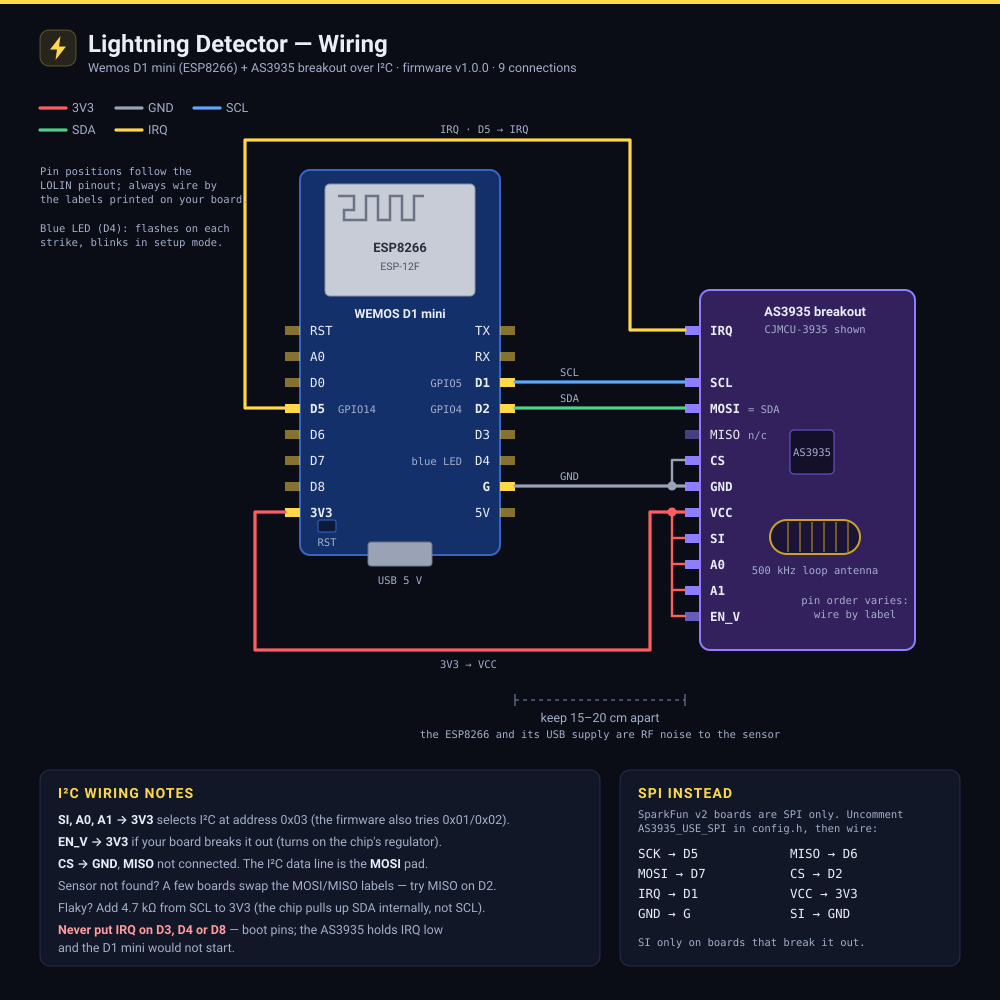

# NodeMCU Lightning Detector

A Wemos D1 mini (ESP8266) with an AS3935 lightning sensor. It logs every
strike with its distance, and serves a dashboard on your network with:

- a status banner ("All clear", "Lightning 14 km away", "Within 10 km") and
  storm trend (approaching / moving away)
- a **map**: drop a pin where the sensor is, and each strike distance is drawn
  as a ring around it, coloured by age (the AS3935 measures distance, not
  direction)
- a distance-over-time chart, the strike log with CSV download
- sensor settings, antenna auto-tuning, and a "Simulate strike" button for
  testing without a storm

First-time setup works like a smart plug: the detector raises its own Wi-Fi
network with a setup page where you pick your home Wi-Fi.

## Parts

- Wemos / LOLIN D1 mini (ESP8266)
- AS3935 breakout: CJMCU-3935, DFRobot Gravity (I2C), or SparkFun v2 (SPI)
- USB power supply, a few jumper wires

## Wiring (I2C)

| AS3935 | D1 mini |
|---|---|
| VCC | 3V3 |
| GND | G |
| SCL | D1 |
| MOSI (the I2C data pad) | D2 |
| IRQ | D5 |
| SI, A0, A1, EN_V (if present) | 3V3 |
| CS | G |
| MISO | not connected |

Keep the sensor **15–20 cm away** from the D1 mini and its USB supply. It
listens at 500 kHz and hears electrical noise. The firmware keeps its own
Wi-Fi as quiet as it can (radio always awake, transmit power trimmed to what
your signal needs), and the Disturbers tile shows how many disturbers came
right after Wi-Fi traffic, so you can tell whether Wi-Fi is the problem.

SPI wiring and more detail are in [`config.h`](LightningDetector/config.h) and
[`HANDOFF.md`](LightningDetector/HANDOFF.md).

## Flash

1. Arduino IDE with the ESP8266 core (Boards Manager: "esp8266", 3.1.2 tested).
2. Tools → Board → **LOLIN(WEMOS) D1 R2 & mini**.
3. Tools → Flash Size → **4MB (FS:2MB OTA:~1019KB)** (needed for the log).
4. Open `LightningDetector/LightningDetector.ino` and upload. No extra
   libraries are needed.

Later updates can go over Wi-Fi at `http://lightning.local/update`.

## Set up

1. Power it up. The blue LED blinks once a second.
2. On your phone, join the Wi-Fi network **LightningDetector-Setup**. The setup
   page opens (or browse to `http://192.168.4.1`). On iPhone, turn off
   Cellular Data if it doesn't load.
3. Pick your network, enter the password, tap **Connect**.
4. Back on your home Wi-Fi, open **http://lightning.local** (or the IP your
   router shows for "lightning").
5. Click **Place sensor**, then click the map where the detector is, or search
   your address. Drag the pin to the exact spot and click **Save location**.

On first boot the detector tunes its antenna by itself (about 9 seconds). You
can re-run it from the Antenna panel.

## Notes

- This is a hobby sensor, not a safety device.
- The map and address search need internet access; the log, chart and
  settings work without it.
- Distances are the chip's estimate to the leading edge of the storm.
